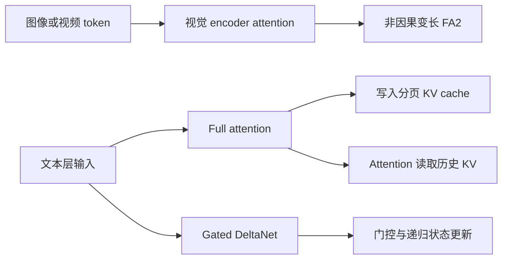

# 第 1 课：先明确算子做了什么

## 目标

能把“模型中的作用”“数学计算”“物理存储”分开解释，并指出哪些输出通过原地写入产生。



沿仓库的 `qwen3_5.py` 追踪 `linear_attention/full_attention` 分支，再沿视觉实现找到 `MMEncoderAttention`。不要把视觉 encoder 的无缓存 attention、文本 KV cache 和 GDN 的递归状态当成同一个存储系统。

## 契约表

| 算子 | 数据形状 | 结果位置 |
|---|---|---|
| Cache | K/V `[T,H,D]`、slot `[T]` | 原地修改 cache，返回值不是主要输出 |
| Dynamic cache | K `[T,H,Dk]`、V `[T,H,Dv]` | 量化 cache 与独立的 K/V scale cache |
| Encoder attention | packed Q/K/V `[T,H,D]`、cu `[B+1]` | 新的 `[T,H,D]` 输出 |
| Delta rule | Q/K `[T,H,K]`、V `[T,HV,V]` | 输出 `[T,HV,V]`，并更新 `[pool,HV,V,K]` 状态 |

`cu=[0,2,5]` 表示两个独立序列，token 范围为 `[0,2)` 和 `[2,5)`。注意力不能跨越这两个范围。负 slot 表示跳过写入；状态索引 0 是保留项，这两个规则互不替代。

## 练习

1. 给定 `T=3,H=2,D=4`，普通缓存写入多少个 K 元素和 V 元素？负 slot 对结果有什么影响？
2. 只对比函数返回的 output，能发现写坏其他缓存页或状态池的问题吗？
3. `H=2,HV=4` 时，value head 0、1、2、3 分别使用哪个 Q/K head？
4. 根据 [api.py](../qwen35_lab/api.py)，给四个入口补上输入 dtype、stride 和副作用说明。

## 动手

从仓库根目录执行：

```bash
.venv/bin/python 02-triton-kernels/qwen35-cuda/run.py list
.venv/bin/python 02-triton-kernels/qwen35-cuda/run.py check --case cache_decode --impl baseline
```

本课只要求看懂输入到输出的关系。读 [reference.py](../qwen35_lab/reference.py)，画出你自己的数据流图，再对照 [答案](ANSWERS.md#第-1-课)。

过关：不看代码能解释三个状态系统的区别，并明确每个算子该比较哪些张量。
